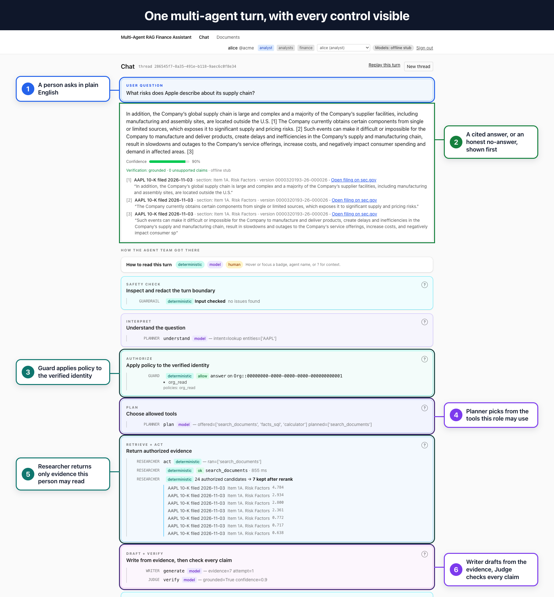
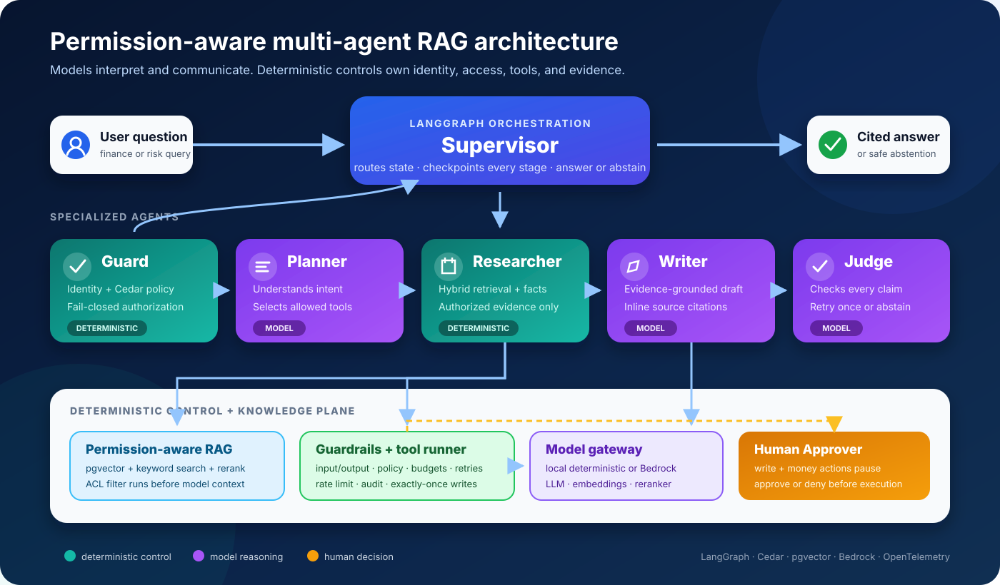

# Multi-Agent RAG Finance Assistant

A production-shaped reference architecture for **multi-agent artificial intelligence (AI)** and
**retrieval-augmented generation (RAG)**: specialized AI agents research company documents, enforce
document-level permissions, cite their evidence, and require human approval before taking action.

[](https://github.com/stevenmcconnon/multi-agent-finance-example/actions/workflows/ci.yml)
[](LICENSE)
[](pyproject.toml)
[](infra/terraform)

Built as an **agentic AI architect and engineer portfolio project**, the repository demonstrates how to
move from a generative AI and large language model (LLM) prototype to an enterprise-ready design. It
combines multi-agent orchestration, permission-aware RAG, LLM guardrails, human-in-the-loop approval, Model Context Protocol
(MCP) tools, evaluation, observability, and Amazon Web Services (AWS) infrastructure in one runnable system.



The annotated turn shows the core architecture in the running product: the **Guard** authorizes the
request, the **Researcher** retrieves only permitted evidence, the **Writer** drafts from that evidence,
and the **Judge** verifies the answer before delivery.

## Agentic AI architecture highlights

- **Multi-agent system:** a Supervisor coordinates Guard, Planner, Researcher, Writer, Judge, and human
  Approver roles through a checkpointed LangGraph state machine.
- **Permission-aware RAG pipeline:** a Postgres and pgvector vector database combines semantic search,
  keyword search, and reranking while applying access control before evidence enters the LLM context window.
- **Agent tools, tool calling, and MCP:** every tool call uses the same policy-enforced runner whether it
  comes from the web application, the agent graph, or a Model Context Protocol client.
- **LLM safety and guardrails:** deterministic identity, authorization, tool policy, budgets,
  idempotency, and citation checks bound the non-deterministic model steps.
- **Human-in-the-loop agent workflow:** write actions pause for explicit approval and can execute
  only once after resumption.
- **LLMOps and AI observability:** audit events, OpenTelemetry traces, graph checkpoints, adversarial
  evaluations, and citation-quality tests make agent behavior inspectable.
- **Enterprise AI security and governance:** fail-closed authorization, prompt-injection tests,
  permission-leak evaluations, audit trails, and explicit demo limitations make trust boundaries visible.
- **Cloud architecture:** Docker supports the local development stack, while Terraform describes an AWS
  deployment using Bedrock, Cognito, Verified Permissions, Fargate, and managed data services.

## What the demo does

The application answers questions over real Apple and Microsoft filings from the U.S. Securities and
Exchange Commission (SEC). Those public filings stand in for a private company document library.

A user can:

- ask a finance or risk question in plain English;
- receive an answer tied to the exact source passages or financial facts;
- see the agent team plan, research, write, and verify the response;
- compare the same question under different document permissions;
- approve or deny a proposed write action; and
- replay the full decision trail after the turn completes.

The important result is not simply “chat with documents.” It is a controlled multi-agent RAG system in
which an unauthorized passage never reaches the LLM, financial numbers come from structured facts, and an
AI agent cannot execute a write by itself.

### The five-minute walkthrough

| Step | Try this | What it demonstrates |
|---|---|---|
| 1 | Sign in as **alice** and ask about Apple’s supply-chain risks | A grounded answer with source citations and a visible agent timeline |
| 2 | Re-ask the same question as **bob** | The system abstains when the user cannot access relevant documents |
| 3 | Ask for Apple revenue | A number is retrieved from structured filing data rather than generated from model memory |
| 4 | Sign in as **carol** and create a review ticket | The run pauses until a human approves or denies the action |
| 5 | Open **Replay** and **Documents** | Every step is checkpointed, and document visibility is enforced on the server |

See [the complete demo script](docs/DEMO.md) for the prompts, screenshots, and narration.

## How the multi-agent system works

A Supervisor orchestrates six specialized agent roles. Deterministic code owns permissions, tool
execution, and routing; LLM agents handle interpretation and language; a person owns approval. This
separation makes the multi-agent workflow easier to test, audit, and evolve than a single unconstrained
agent with direct access to data and tools.

| Role | Type | Responsibility |
|---|---|---|
| **Supervisor** | Deterministic | Routes the turn, checkpoints each stage, and chooses answer or abstention |
| **Guard** | Deterministic | Applies authorization policy to the already-verified identity; fails closed |
| **Planner** | Model | Interprets the question and selects from the tools the user is allowed to call |
| **Researcher** | Deterministic | Retrieves authorized passages or structured financial facts |
| **Approver** | Human | Approves or denies write actions |
| **Writer** | Model | Drafts an answer using only the retrieved evidence |
| **Judge** | Model | Checks the draft against that evidence before it is returned |



Teal components are deterministic controls, purple components are model-driven agents, and amber marks the
human approval boundary. LangGraph orchestrates the interactive agent turn. A separate Temporal workflow
handles document ingestion, where long-running retries and resumable jobs matter more than conversational
state. The default quickstart runs the same ingestion steps inline; `docker compose --profile temporal up -d`
runs them as Temporal workflows.

## System design at a glance

The system follows one request through seven layers:

- **L7 Experience:** a React web application, streaming FastAPI interface, and Model Context Protocol server.
- **L6 Orchestration:** the LangGraph Supervisor coordinates the multi-agent workflow and stores checkpoints.
- **L5 AI Harness:** one guarded agent-tool runner applies policy, approval, timeouts, retries,
  budgets, and idempotency; turn-boundary checks redact personal data, tag injection patterns, check output,
  and rate-limit each principal.
- **L4 Knowledge / Retrieval:** pgvector semantic search, keyword retrieval, reranking, and structured facts
  share a database-level permission filter.
- **L3 Models:** one LLM gateway selects local deterministic behavior or Amazon Bedrock foundation models.
- **L2 Data / Pipelines:** an ingestion workflow parses filings into searchable passages and structured
  financial facts.
- **L1 Cloud / Platform:** Docker runs the local stack; Terraform describes the Amazon Web Services deployment.


Three design choices carry most of the project’s value:

- **Permission filtering happens before retrieval results reach a model.** The same database predicate
  protects semantic search, keyword search, structured facts, and the Documents page.
- **Model judgment is bounded by deterministic controls.** A model may rank authorized evidence or choose
  an allowed tool; it cannot grant permissions, bypass approval, or execute a tool directly.
- **Every important step is inspectable.** Policy decisions, retrievals, tool calls, approvals, answers,
  traces, and graph checkpoints all leave evidence for debugging or audit.

For the request-level code path, read the [guided code tour](docs/TOUR.md). For component boundaries and
adapter choices, read the [architecture guide](docs/ARCHITECTURE.md).

## Repository guide

| Path | What it contains |
|---|---|
| [`apps/web/`](apps/web/) | React user interface: sign-in personas, chat, approval cards, documents, and replay |
| [`services/finance_agents/agent/`](services/finance_agents/agent/) | Supervisor graph, agent roles, state, checkpoints, and approval interrupts |
| [`services/finance_agents/harness/`](services/finance_agents/harness/) | Identity, tool registry, guarded tool runner, budgets, retries, and idempotency |
| [`services/finance_agents/guardrails/`](services/finance_agents/guardrails/) | Input/output checks, personal-data redaction, per-user rate limiting, and Bedrock Guardrails |
| [`services/finance_agents/retrieval/`](services/finance_agents/retrieval/) | Permission-filtered semantic, keyword, and structured-fact retrieval |
| [`services/finance_agents/authz/`](services/finance_agents/authz/) | Cedar policy adapters, group resolution, and audit records |
| [`services/finance_agents/gateway/`](services/finance_agents/gateway/) | The single gateway for local and Amazon Bedrock model backends |
| [`services/finance_agents/ingest/`](services/finance_agents/ingest/) | SEC filing discovery, parsing, chunking, fact extraction, and Temporal workflows |
| [`services/finance_agents/api/`](services/finance_agents/api/) | FastAPI routes and server-sent event streaming |
| [`services/finance_agents/mcp_server/`](services/finance_agents/mcp_server/) | The same guarded tools exposed through the Model Context Protocol |
| [`db/`](db/) | Postgres schema, seed data, document permissions, and Cedar policies |
| [`evals/`](evals/) | Permission-leak, citation-quality, and optional model-quality evaluations |
| [`tests/`](tests/) | Unit, integration, and architecture tests across the system |
| [`infra/`](infra/) | Docker support, observability configuration, and Terraform modules |
| [`docs/`](docs/) | Architecture, security, demo, decisions, diagrams, and dated review records |
| [`scripts/`](scripts/) | Repeatable teardown and operational helpers |

Each major folder has a short README explaining its boundary and pointing to the relevant code.

## Run it locally

The default local path costs $0 and does not call Amazon Web Services. It uses a deterministic model
gateway so the complete control flow can be tested without credentials.

### Prerequisites

- Docker with Docker Compose
- an email address for the SEC request header
- `uv` and `pnpm`, only for `make test` and `make lint`

The SEC’s Electronic Data Gathering, Analysis, and Retrieval system (EDGAR) requires automated clients to
identify themselves with an application name and contact email.

### Start the stack

```sh
cp .env.example .env
# Set EDGAR_USER_AGENT in .env, for example:
# EDGAR_USER_AGENT=multi-agent-finance-example you@example.com

make up
make ingest
```

`make ingest` loads a pinned set of five filings (two annual reports, three current reports) and warms the
models. Open [http://localhost:3000](http://localhost:3000). The first start downloads the required
container images; the local embedding and reranking models download on the first ingest.

Useful commands:

```sh
make logs    # follow service logs
make test    # run the test and evaluation suites
make lint    # run formatting, lint, and type checks
make down    # stop the local stack
```

The local stack includes the web app, API, Postgres with vector search, Valkey, Temporal, an OpenTelemetry
collector, and Phoenix tracing. See [the port list](docs/CONTRACTS.md#ports) if a local port is already in
use; set `WEB_PORT` to move the web app.

## Production-shaped, with explicit demo shortcuts

This repository implements production boundaries, but it does not claim production scale. Where the demo
takes a lower-cost path, the tradeoff is stated explicitly. The cloud paths (Bedrock models and Guardrails,
Cognito sign-in, the Temporal worker, and the Terraform) are validated or unit-tested with stubs and have not
been run live.

> In production: company documents and their real permissions come from a system such as SharePoint.
>
> In this demo: public SEC filings receive simulated document permissions, because the corpus is free,
> versioned, and contains both narrative text and structured financial facts.

> In production: Amazon Verified Permissions evaluates Cedar policies as a managed service.
>
> In this demo: Cedar is evaluated in process, because local policy checks cost nothing and use the same
> policies and entity mapping.

> In production: Amazon Bedrock language, embedding, and reranking models handle model work.
>
> In this demo: deterministic language behavior and local embedding and reranking models are the defaults,
> because the quickstart must run offline without cloud credentials; `make up-bedrock` uses Claude locally.

> In production: the Terraform-managed Bedrock Guardrail filters every model call and both ends of a turn,
> alongside load-balancer and web-application-firewall limits.
>
> In this demo: deterministic input/output checks and the Redis per-principal limit still run, but managed
> content classification is off, because the local stack makes no AWS calls.

> In production: each person signs in through a real identity provider and approvals may be routed to an
> enterprise workflow.
>
> In this demo: seeded personas and an in-app approval card make permission and approval behavior easy to
> inspect on one laptop.

More detail on the layer boundaries and interchangeable adapters is in the
[architecture guide](docs/ARCHITECTURE.md).

## Tests and evaluation

```sh
uv run --extra dev pytest
```

The automated checks cover:

- identity and authorization failures;
- malformed input, prompt-injection tagging, personal-data redaction, rate limiting, and output checks;
- permission filtering for passages and financial facts;
- grounded answers, abstention, and citation ownership;
- human approval and exactly-once write behavior;
- thread ownership, replay, and API boundaries;
- adversarial attempts to leak forbidden document identifiers; and
- architecture rules, including the requirement that protected queries carry the permission predicate.

Optional Ragas and DeepEval runners measure answer and retrieval quality against a live model backend. See
[the evaluation guide](evals/README.md) for datasets, commands, and limitations.

## Technology

Python 3.11 · FastAPI · LangGraph · Temporal · Postgres · pgvector · Cedar · React · TypeScript · Amazon
Bedrock · Amazon Cognito · Amazon Verified Permissions · OpenTelemetry · Phoenix · Terraform · Docker

## Documentation

- [Demo script](docs/DEMO.md) — what to click, say, and observe
- [Code tour](docs/TOUR.md) — one request from token verification to stored checkpoint
- [Architecture](docs/ARCHITECTURE.md) — layers, interfaces, data stores, and production tradeoffs
- [Security](docs/SECURITY.md) — trust boundaries, threats, and controls
- [Guardrails](docs/GUARDRAILS.md) — every control mapped to its owner, test, and local/cloud behavior
- [Architecture decisions](docs/adr/README.md) — why the major implementation choices were made
- [Documentation index](docs/README.md) — all guides and dated review records

## License

[MIT](LICENSE)
