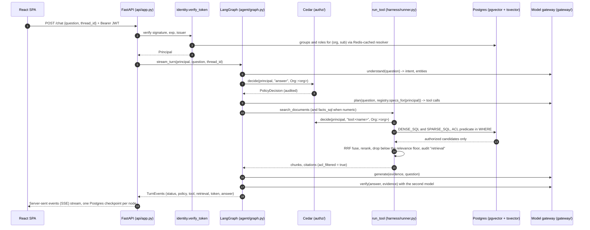
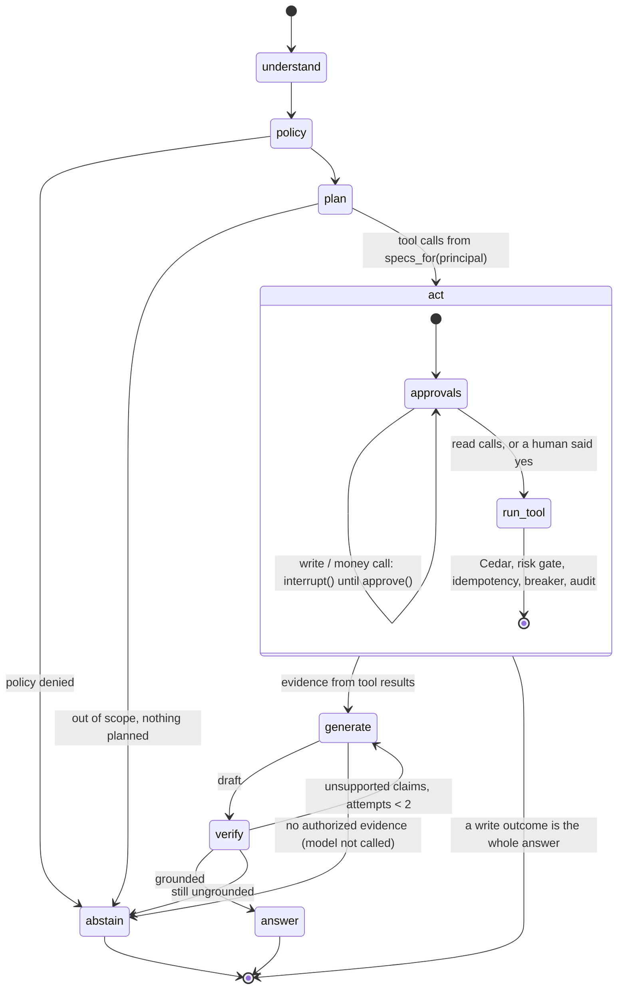

# harness-rag

Permission-safe enterprise retrieval-augmented generation (RAG) and an artificial intelligence (AI) harness for agents that take action, on Amazon Web Services (AWS).

[](https://github.com/stevenmcconnon/harness-rag/actions/workflows/ci.yml)
[](LICENSE)
[](pyproject.toml)
[](infra/terraform)

harness-rag answers questions over documents that carry item-level permissions, and lets an agent call
tools that change things, without ever showing a user a chunk they may not read or running a write nobody
approved. Identity comes from a verified token, authorization from Cedar policies, the permission filter is
a Structured Query Language (SQL) predicate inside every candidate query, and every tool call passes through one guarded door.

The corpus is public filings from the U.S. Securities and Exchange Commission (SEC) Electronic Data Gathering, Analysis, and Retrieval system (EDGAR): Form 10-K (annual report), Form 10-Q (quarterly report) and Form 8-K (current report), with simulated item-level access control lists (ACLs), standing in for a
SharePoint library with Microsoft Graph permissions: the filings are public, the ACLs are the demo's own
(`ingest/acl.py`), and nothing in the retrieval or policy path knows the difference. Three seeded identities
make the behaviour visible: **alice** (analyst; groups finance, analysts) reads 10-K/10-Q and 8-K,
**bob** (viewer; engineering) reads 8-K only, **carol** (admin) may call write tools but belongs to no reader
group.

It demonstrates the full stack of such a system in one repository: Terraform for Amazon Elastic Container Service (ECS) Fargate, Amazon Relational Database Service (RDS),
Cognito, Verified Permissions and Bedrock; a Temporal ingestion pipeline; hybrid pgvector + full-text
retrieval with reciprocal rank fusion (RRF) and reranking; a LangGraph turn with a second-model verifier, human-in-the-loop (HITL)
interrupts and checkpoint replay; a React (Vite) single-page application (SPA) and a Model Context Protocol (MCP) server over the same tools. Where the demo
takes a cheaper path than production, the code and the docs say so in the same two-line form
([Production vs this demo](#production-vs-this-demo)).

## The stack


Deeper: [docs/ARCHITECTURE.md](docs/ARCHITECTURE.md) · code walk: [docs/TOUR.md](docs/TOUR.md) ·
threat model: [docs/SECURITY.md](docs/SECURITY.md) · demo script: [docs/DEMO.md](docs/DEMO.md).

## The security invariant

**An unauthorized chunk never enters a prompt, a reranker, a log, a cache or an eval dataset.** Each place
that could break it has one owner and one test.

| Where it could leak | What enforces it | What proves it |
|---|---|---|
| Candidate retrieval (dense, sparse) | `retrieval/sql.py` `ACL_PREDICATE`, spliced into `DENSE_SQL` and `SPARSE_SQL` in the `WHERE`, before `ORDER BY`/`LIMIT` | `tests/test_retrieval.py::test_acl_predicate_in_dense_and_sparse_and_facts`; `tests/test_architecture.py::test_every_chunk_or_fact_query_carries_the_acl_predicate`; database-backed `test_db_acl_filters_rows_end_to_end` |
| Fusion and rerank | `retrieval/hybrid.py` `PgHybridRetriever.retrieve`: `rrf_fuse` and `Reranker.rerank` only ever see rows those two queries returned | `tests/test_retrieval.py::test_retriever_fuses_and_audits` (the injected fetch asserts the predicate and the principal's groups on every call) |
| Numeric facts | `retrieval/sql.py` `FACTS_SQL` carries the same predicate; `tools.cedar` also denies `facts_sql` to viewers | `tests/test_authz.py::test_facts_sql_tool_requires_analyst_or_admin`; `evals/suites/test_permission_leak.py::test_viewer_tool_denied_by_cedar_not_by_registry` |
| The prompt | `agent/graph.py` `_evidence` builds the model's evidence only from `state["chunks"]`/`state["facts"]`, which only `harness.runner.run_tool` fills; `harness/tools/search_documents.py` refuses a result whose `acl_filtered` is not `True`; with no evidence the model is not called | `tests/test_agent.py::test_zero_authorized_chunks_abstains_without_calling_the_model`; `evals/suites/test_permission_leak.py` |
| Identity | `harness/identity.py` `verify_token`: signature and `exp` (required) checked; Cognito mode takes the user from `cognito:username` and the org from the one `org:<slug>` group; groups and roles come from the database through `authz/group_cache.py`, never from the token's hint or the prompt; `authz/entities.py` drops unknown roles; `check_config()` refuses to boot `HR_MODE=aws` on local JSON Web Token (JWT) settings | `tests/test_identity.py` (`test_cognito_token_groups_are_only_a_hint`, `test_local_missing_exp_rejected`, `test_cognito_missing_exp_rejected`, `test_check_config_refuses_aws_with_local_jwt`); `tests/test_authz.py::test_prompt_cannot_grant_roles`; `evals/datasets/permission_leak.jsonl` `bob-prompt-injection` |
| Caches | `authz/group_cache.py` caches principal resolution (a denial too), never documents; `harness/runner.py` checks Cedar and the risk gate before it reserves an idempotency key (`org:tool:<call key>`) and stores only authorized results | `tests/test_authz.py::test_group_cache_caches_denial_and_survives_redis_failure`; `tests/test_harness.py::test_idempotent_second_call_is_cached`, `::test_idempotency_key_distinguishes_arguments`, `::test_concurrent_same_key_runs_the_tool_once` |
| Writes | `harness/runner.py` `run_tool`: a `write` or `money` tool returns `approval_required` unless the caller passes `approved=True`, which only the graph's HITL path does after a human approves; MCP and the application programming interface (API) never pass it | `tests/test_harness.py::test_write_tool_needs_explicit_approval`; `tests/test_mcp.py::test_carol_write_tool_over_mcp_needs_approval`; `tests/test_agent.py::test_create_ticket_declined_changes_nothing` |
| Irrelevant but readable evidence | `retrieval/hybrid.py` drops reranked chunks scoring below the reranker's own floor (`Reranker.min_score`; `HR_RERANK_MIN_SCORE` overrides), so a reader whose permitted documents do not answer the question gets an abstention | `tests/test_retrieval.py::test_rerank_floor_drops_irrelevant_authorized_chunks` |
| Logs and audit | `authz/audit.py` `record`: the `retrieval` row (`hybrid.py`) lists the document ids of the chunks returned after the predicate, nothing earlier | `evals/suites/test_permission_leak.py` walks every audit row and stream event for a forbidden id |
| Eval datasets | `evals/ragas_eval.py` `cited_contexts` reads back only chunk ids the turn cited for that principal | `evals/suites/test_citation_quality.py` (every citation readable by the asking user) |
| The documents page | `api/app.py` `DOCUMENTS_SQL` reuses the same predicate | `tests/test_architecture.py::test_documents_route_reuses_the_predicate` |
| Threads | `agent/graph.py` `_assert_owner`: replay, resume and continuation belong to the principal who started the thread | `tests/test_agent.py::test_thread_belongs_to_its_owner`; `evals/suites/test_permission_leak.py::test_thread_cannot_be_replayed_by_another_user` |
| Policy outage | `authz/cedar_local.py` and `authz/verified_permissions.py` return `allow=False, fail_closed=True` on any error | `tests/test_authz.py::test_authorizer_exception_fails_closed`, `::test_avp_errors_fail_closed` |

## A request, end to end



## The agent

The turn is `understand -> policy -> plan -> act -> generate -> verify -> answer | abstain`
(`agent/graph.py`). `plan` asks the model to choose tools through Bedrock Converse native tool use, but it
only ever sees `registry.specs_for(principal)`; with `HR_MODEL_BACKEND=fake` the plan is a deterministic
heuristic. `act` runs every chosen call through `harness/runner.py` (Cedar, risk gate, idempotency,
timeout, retries, breaker, audit). The HITL `interrupt()` sits inside `act`, before a write or money call
runs, and `approve()` resumes it (architecture decision record [ADR 0008](docs/adr/0008-model-driven-tool-selection.md)).



Two orchestrators at two grains: LangGraph runs the turn (seconds, checkpointed, replayable, resumable
after a human), Temporal runs ingestion (minutes to hours, retried with backoff, dead-lettered). And a
deterministic / non-deterministic split: identity, policy, the SQL ACL filter, fusion, the facts table and
calculator, budgets and breakers are deterministic; only the four model calls (understand, plan, generate,
verify) are not, and each sits between a deterministic gate before it and after it.

## Ingestion

```mermaid
flowchart LR
    E[SEC EDGAR\nsubmissions + companyfacts JavaScript Object Notation (JSON)\nUser-Agent from EDGAR_USER_AGENT] --> D[DiscoverWorkflow\nnewest N filings per ticker]
    D -->|one child workflow per filing\nid = idempotency key| F[IngestFilingWorkflow]
    F --> C1[claim\ningest_jobs row]
    C1 --> C2[fetch\noriginal to S3 or data/edgar]
    C2 --> C3[parse_and_write\nparse.py sections, chunk 700/80 words\nfacts.py eXtensible Business Reporting Language (XBRL) facts for this accession\nembed 512-dim\nwriter.py one transaction]
    C3 --> C4[finish]
    C4 --> P[(Postgres\ndocuments, document_acl, chunks, facts)]
    F -.->|5th failure| X[ingest_jobs.status = dead]
```

Retries, backoff and the dead letter are Temporal's and the `ingest_jobs` table's; there is no queue
service in the path ([ADR 0003](docs/adr/0003-temporal-owns-ingestion-durability.md) says when one would be
the better answer). The same activities run inline without Temporal (`cli run --inline`), which is how the
local quickstart ingests.

## AWS deployment


Terraform lives in `infra/terraform` (modules `network`, `database`, `cache`, `web`, `identity`, `policy`,
`observability`, `compute`, `schedule`; environment `envs/dev`). The Cedar policies in `db/policies` are the
same files `modules/policy` uploads to the Verified Permissions store, so switching `HR_AUTHZ_BACKEND`
changes where Cedar runs, not what it decides.

## Quickstart (local, $0)

Requires Docker, `uv`, and `pnpm`. Nothing calls AWS; models are the fake gateway and local Open Neural Network Exchange (ONNX) models.

```sh
cp .env.example .env
# EDGAR answers 403 without an app name and a contact e-mail in the User-Agent: edit this line.
#   EDGAR_USER_AGENT=harness-rag you@example.com
make up            # Postgres (pgvector), Valkey, Temporal dev server, Phoenix, OTel collector, api, web; the api container applies db/migrations (0002 seeds acme, alice, bob, carol) before it serves
make ingest        # AAPL and MSFT, 10-K and 8-K, newest 2 each, inline (no Temporal needed for this)
```

The web app is at http://localhost:3000, the API at http://localhost:8000, Temporal user interface (UI) at :8233, Phoenix
traces at :6006. Sign-in is a persona picker (local mode only); once in, the header has a persona switcher.

1. Pick **alice** ([sign-in](docs/screenshots/01-signin.png)) and ask:
   `What risks does Apple describe about its supply chain?` The timeline shows `policy`, `plan`, `tool`,
   `retrieval` (candidate count and the chunks' sections), `token`, `answer` with citations into the 10-K
   ([screenshot](docs/screenshots/02-alice-chat.png)).
2. Under the answer, click **Re-ask as bob**. The same question runs as bob in a second column
   ([screenshot](docs/screenshots/10-persona-compare.png)). bob may read the 8-Ks only, and they do not
   answer it, so the turn abstains: *I can't answer that from the documents you have access to.* Nothing
   from the 10-K entered the prompt, the reranker or the audit row.
3. Open **Documents** as each: alice sees the 10-K and the 8-Ks, bob the 8-Ks
   ([alice](docs/screenshots/03-alice-documents.png), [bob](docs/screenshots/06-bob-documents.png)).
4. Click **Replay this turn**: the checkpoints the Postgres saver wrote, one per node, oldest first
   ([screenshot](docs/screenshots/04-replay.png)).
5. Switch to **carol** and ask `Create ticket: follow up on AAPL risk factors`. The turn stops at an
   approval card ([screenshot](docs/screenshots/07-carol-hitl.png)); Deny and nothing is created, Approve
   and the tool runs once under an idempotency key.

Same tools over MCP, same door:
`HR_TOKEN=$(uv run python -m harness_rag.harness.devtoken alice) uv run python -m harness_rag.mcp_server.server`.
Write tools are listed for an admin but answer `approval_required`: approval happens only in the UI.

## Deploy to AWS

```sh
cd infra/terraform/envs/dev
terraform init && terraform apply          # VPC, RDS, Valkey, Cognito, Verified Permissions, ECS, ALB, CloudFront, scheduler
cd ../../../../apps/web && pnpm build && aws s3 sync dist s3://<web_bucket from the outputs>
make tf-destroy                             # scripts/teardown.sh: empties ECR, then terraform destroy; nothing keeps billing
```

The dev environment is sized to list prices of about **$5/day** (`infra/terraform/COST.md` itemizes it;
nothing there was metered from a live run). `.github/workflows/deploy.yml` builds images and stops at
`terraform plan`; `apply` stays a human command.

## Sizing, honestly

No load, latency or scale figure in this repository was measured, so none is claimed. The questions a
production sizing starts from, and what changes with the answers:

- **Peak queries per second (QPS) versus concurrent users.** A turn is up to four model calls (understand, plan, generate, verify) plus two SQL queries and a rerank; the
  model calls dominate wall time and Bedrock quotas, not the database. Size Fargate on concurrent streams,
  not requests per second.
- **95th-percentile latency (p95) target.** The rerank and the verifier are the two optional stages: the verifier can be sampled, the
  reranker dropped to `HR_RERANK_BACKEND=none`, each with a measured quality cost first.
- **Churn and freshness.** Each filing version is one idempotent job; `writer.py` skips an unchanged
  content hash and replaces children on a changed one. A permission change on SharePoint is an ACL row
  update plus a `GroupCache.invalidate` for affected users; the 300-second time to live (TTL) bounds how stale a
  membership can be.
- **At 5 to 20 million chunks.** pgvector Hierarchical Navigable Small World (HNSW) index build time and the index's memory footprint become the
  constraint before query latency does; partition by org (or move to one database per large tenant), tune
  `ef_search`, and expect the ACL `EXISTS` to be the planner's hardest decision: it may need a materialized
  `(document_id, principal_id)` join or a denormalized readers array on `chunks`.
- **When OpenSearch wins.** When sparse retrieval needs Best Match 25 (BM25) ranking with field boosts and analyzers Postgres
  full-text does not offer, when the index must scale independently of the transactional database, or
  when near-real-time replication of millions of ACL changes outgrows row updates. Until then one store
  with one predicate is simpler to prove correct ([ADR 0001](docs/adr/0001-pgvector-over-opensearch.md)).

## Production vs this demo

| Concern | In production | In this demo, because |
|---|---|---|
| Policy evaluation | Amazon Verified Permissions (`authz/verified_permissions.py`) | Cedar in process with `cedarpy` (`authz/cedar_local.py`); same policies, same entity mapping; no AWS call per decision at $0 |
| Generation / verification | Claude Sonnet 4.5 generates, Claude Haiku 4.5 verifies and classifies, on Bedrock | `gateway/fake.py`: deterministic answers built only from the evidence lines; offline tests |
| Embeddings | Titan Text Embeddings v2 at 512 dimensions | `jinaai/jina-embeddings-v2-small-en` via fastembed, also 512, so the column never changes |
| Reranker | Cohere Rerank 3.5 on Bedrock | `BAAI/bge-reranker-base` via fastembed |
| Corpus and ACLs | SharePoint with Microsoft Graph permissions | EDGAR public filings with ACLs assigned by form (`ingest/acl.py`); public data, no connector licence |
| Identity | Cognito, authorization code + Proof Key for Code Exchange (PKCE), RSA-signed (RS256) JSON Web Key Set (JWKS); one person, one sign-in; user from `cognito:username`, org from the `org:<slug>` group | HMAC-signed (HS256) development tokens from `/auth/dev-token`, local issuer; groups still resolved from the database; `HR_MODE=aws` refuses to boot on these settings |
| Persona switch | None: a user is one Cognito identity | A header persona switcher and "Re-ask as <persona>" chips (local mode only), because the demo's point is the same question under different permissions |
| Relevance floor | `HR_RERANK_MIN_SCORE` tuned against the production reranker's score scale on labelled questions | Each reranker carries a default (Best General Embeddings (BGE) logits 0.0, Cohere relevance 0.15) set from one observed failure (bob on the Apple question), not tuned ([ADR 0009](docs/adr/0009-rerank-relevance-floor.md)) |
| Idempotency rows | A retention job expires old `idempotency_keys` rows | Rows never expire; nothing deletes them |
| Approvals | A human approves in the product UI; other channels cannot | Same: only the UI path passes `approved=True`; MCP is read-only for write tools |
| Durable ingestion | Temporal on Fargate or Temporal Cloud, workers as a service | `temporal server start-dev` in compose; `cli run --inline` runs the same activities without it |
| Raw originals | S3 (`S3_RAW_BUCKET`) | `data/edgar/` when no bucket is set; one laptop |
| Tool selection | Claude picks tools via Bedrock Converse tool use over `specs_for(principal)` | `gateway/fake.py` `plan_heuristic`: facts for numeric questions, a regex for the one write tool, else search; Bedrock falls back to it if the planner call fails |
| Ticketing | Jira / ServiceNow client | `create_ticket` writes an audit row; the approval path is the real one |
| Section detection | Layout-aware splitter (Item N. headings); Portable Document Format (PDF) via PyMuPDF or Textract | `h1`–`h6` only, rest is `preamble`; HyperText Markup Language (HTML) only, because EDGAR primary documents are HTML (`ingest/parse.py`) |
| EDGAR coverage | Paged `filings.files` history | `filings.recent` only (`ingest/edgar.py`) |
| Network | Private subnets, network address translation (NAT) or egress endpoints | Public subnets, no NAT (`modules/network`), saves ~$33/month |
| Terraform state | Remote state with locking | Local state in `envs/dev`, so a clone can `init` with no pre-existing resource |
| Deploy | `apply` from a reviewed plan in a protected environment | `deploy.yml` stops at `plan` |
| Tracing | Sampled, collector fans out to X-Ray / Tempo and Phoenix | Every span to both local endpoints (`observability/otel.py`) |
| Checkpoints in tests | `AsyncPostgresSaver` | `MemorySaver`, injected by `graph.configure` |

## Repository layout

| Folder | Layer | Owner module |
|---|---|---|
| `infra/terraform`, `infra/otel`, `infra/grafana` | L1 Cloud / Platform | `envs/dev/main.tf` |
| `services/harness_rag/ingest` | L2 Data / Pipelines | `workflow.py` (Temporal), `writer.py` (one transaction per filing) |
| `services/harness_rag/gateway` | L3 Models | `bedrock.py`, `fake.py`; `retrieval/embed.py`, `retrieval/rerank.py` |
| `services/harness_rag/retrieval`, `services/harness_rag/authz` | L4 Knowledge / Retrieval | `sql.py` (the predicate), `hybrid.py`, `facts.py`; `cedar_local.py`, `group_cache.py`, `audit.py` |
| `services/harness_rag/harness` | L5 AI Harness | `identity.py`, `registry.py`, `runner.py`, `budget.py`, `tools/` |
| `services/harness_rag/agent` | L6 Orchestration | `graph.py` |
| `apps/web`, `services/harness_rag/api`, `services/harness_rag/mcp_server` | L7 Experience | React (Vite) SPA; `api/app.py`; `mcp_server/server.py` |
| `services/harness_rag/{contracts,interfaces,config,db}.py` | Shared | typed contracts, ports, settings, the Postgres door |
| `db/migrations`, `db/policies` | Schema and policy | `0001_schema.sql`, `documents.cedar`, `tools.cedar` |
| `tests`, `evals` | Proof | see below |
| `docs` | Decisions | `ARCHITECTURE.md`, `SECURITY.md`, `TOUR.md`, `DEMO.md`, `adr/` |

The UI is a Vite + React + TypeScript SPA (React Router, Tailwind, Zod), built to static `dist/` files behind
nginx locally or S3 + CloudFront on AWS. It is a pure client over the server-sent events (SSE) interface with nothing to render on a
server, so there is no Next.js.

## Tests and evals

```sh
uv run pytest tests evals/suites -q   # 140 passed on 2026-11-10; DB-backed cases skip unless DATABASE_URL answers
uv run pytest evals/suites -q         # the permission-leak and citation suites alone
```

- `tests/test_authz.py`, `test_retrieval.py`, `test_ingest.py`, `test_harness.py`, `test_agent.py`,
  `test_gateway.py`: unit tests per layer, offline, with injected fetches, fake Redis and `MemorySaver`
  (`test_gateway.py` covers the fake planner and Bedrock tool-use parsing with a stubbed client).
- `tests/test_identity.py`: local and Cognito claim mapping, missing and expired `exp`, wrong key,
  `check_config`. `tests/test_api.py`: dev token, chat stream, foreign-thread 403, input limits, `/healthz`
  503, aws boot refusal. `tests/test_mcp.py`: the MCP server per principal (database-backed).
- `tests/test_architecture.py`: the rules as tests: `boto3` only behind its doors, the agent never imports
  psycopg, every chunk or fact query carries the predicate before `LIMIT`, the documents route reuses it.
- `evals/suites/test_permission_leak.py`: eight adversarial cases (`evals/datasets/permission_leak.jsonl`)
  through the real graph; asserts abstention or a readable-only answer, and no forbidden document id in any
  event, citation or audit row.
- `evals/suites/test_citation_quality.py`: twelve cases (`evals/datasets/qa.jsonl`); every non-abstained
  answer is verifier-grounded and cites a readable document of the required form. No gold answers.
- `evals/ragas_eval.py`, `evals/deepeval_eval.py`: optional graded evals (faithfulness, answer relevancy,
  context precision / relevancy) against the live stack with `uv run --extra evals`; they skip without a
  Bedrock backend and write to `eval_records`. Details in [evals/README.md](evals/README.md).
- Records of the review passes: [docs/AUDIT_2026-11-10.md](docs/AUDIT_2026-11-10.md) (code audit),
  [docs/QA_2026-11-10.md](docs/QA_2026-11-10.md) (exploratory quality assurance, QA).

## Decisions

- [0001 pgvector over OpenSearch](docs/adr/0001-pgvector-over-opensearch.md)
- [0002 Cedar for authorization](docs/adr/0002-cedar-for-authorization.md)
- [0003 Temporal owns ingestion durability](docs/adr/0003-temporal-owns-ingestion-durability.md)
- [0004 EDGAR as the corpus](docs/adr/0004-edgar-as-the-corpus.md)
- [0005 512-dimension embeddings](docs/adr/0005-512-dim-embeddings.md)
- [0006 No LangChain retrieval abstractions](docs/adr/0006-no-langchain-retrieval-abstractions.md)
- [0007 PKCE, not the implicit flow](docs/adr/0007-pkce-not-implicit.md)
- [0008 Model-driven tool selection](docs/adr/0008-model-driven-tool-selection.md)
- [0009 Rerank relevance floor](docs/adr/0009-rerank-relevance-floor.md)

Cross-layer types and entry points are pinned in [docs/CONTRACTS.md](docs/CONTRACTS.md).

## Built with

FastAPI · LangGraph · psycopg 3 · pgvector · cedarpy · Temporal · fastembed · boto3 (Bedrock, Verified
Permissions, S3) · Tenacity · pybreaker · OpenTelemetry · Arize Phoenix · MCP · React (Vite) · Tailwind · Zod ·
Terraform.

## Glossary

- **10-K, 10-Q, 8-K:** U.S. SEC annual, quarterly and current-event report forms.
- **ACL:** access control list, who may read a document or item.
- **ADR:** architecture decision record, a short note on one design choice.
- **AI:** artificial intelligence.
- **ALB:** Application Load Balancer, the AWS front door for web traffic.
- **API:** application programming interface.
- **AWS:** Amazon Web Services.
- **BGE:** Best General Embeddings, the family of the local reranking model.
- **BM25:** Best Match 25, a classic keyword-ranking formula.
- **ECR:** Amazon Elastic Container Registry, where container images are stored.
- **ECS:** Amazon Elastic Container Service, which runs the containers.
- **EDGAR:** the SEC's public filing system (Electronic Data Gathering, Analysis, and Retrieval).
- **HITL:** human in the loop, a person approves before an action runs.
- **HNSW:** Hierarchical Navigable Small World, a fast vector-search index.
- **HS256:** a signature scheme using one shared secret (HMAC with SHA-256).
- **HTML:** HyperText Markup Language, web pages.
- **JSON:** JavaScript Object Notation, a text data format.
- **JWKS:** JSON Web Key Set, the public keys used to check token signatures.
- **JWT:** JSON Web Token, the signed sign-in token.
- **MCP:** Model Context Protocol, a standard way for AI tools to call functions.
- **NAT:** network address translation, lets private servers reach the internet.
- **ONNX:** Open Neural Network Exchange, a portable model file format.
- **p95:** 95th-percentile latency, the time 95 percent of requests beat.
- **PDF:** Portable Document Format.
- **PKCE:** Proof Key for Code Exchange, a safe browser sign-in flow.
- **QA:** quality assurance, manual testing.
- **QPS:** queries per second.
- **RAG:** retrieval-augmented generation, answering from retrieved documents.
- **RDS:** Amazon Relational Database Service, managed Postgres.
- **RRF:** reciprocal rank fusion, merging two ranked lists.
- **RS256:** a signature scheme using a public/private key pair (RSA with SHA-256).
- **S3:** Amazon Simple Storage Service, file storage.
- **SEC:** the U.S. Securities and Exchange Commission.
- **SPA:** single-page application, a web app that loads once.
- **SQL:** Structured Query Language, how the database is queried.
- **SSE:** server-sent events, a one-way stream from server to browser.
- **TTL:** time to live, how long a cached value stays valid.
- **UI:** user interface.
- **VPC:** Virtual Private Cloud, a private network in AWS.
- **XBRL:** eXtensible Business Reporting Language, tagged financial numbers in filings.

## License

[MIT](LICENSE) © 2026 Steven McConnon
