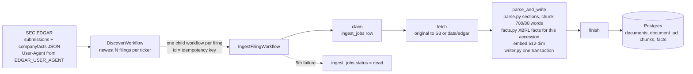
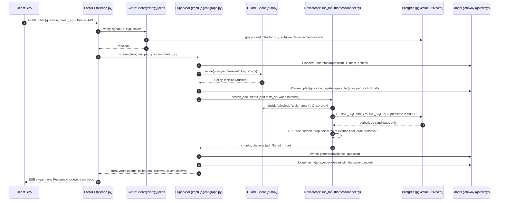
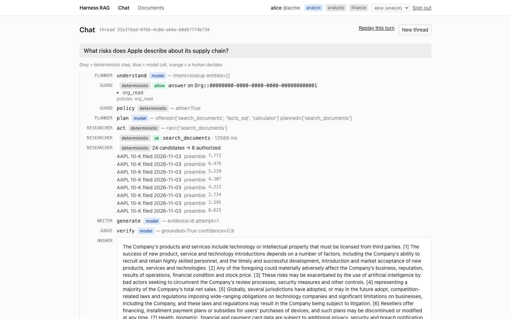
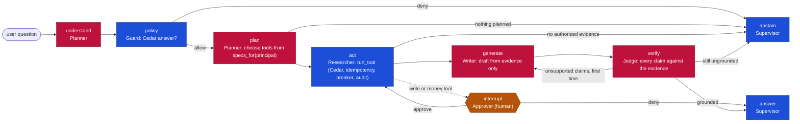
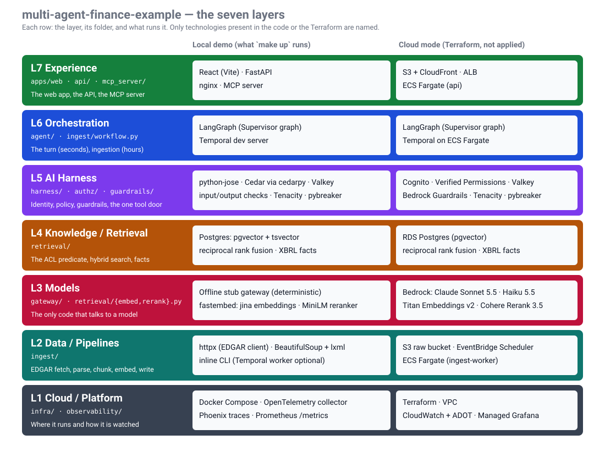
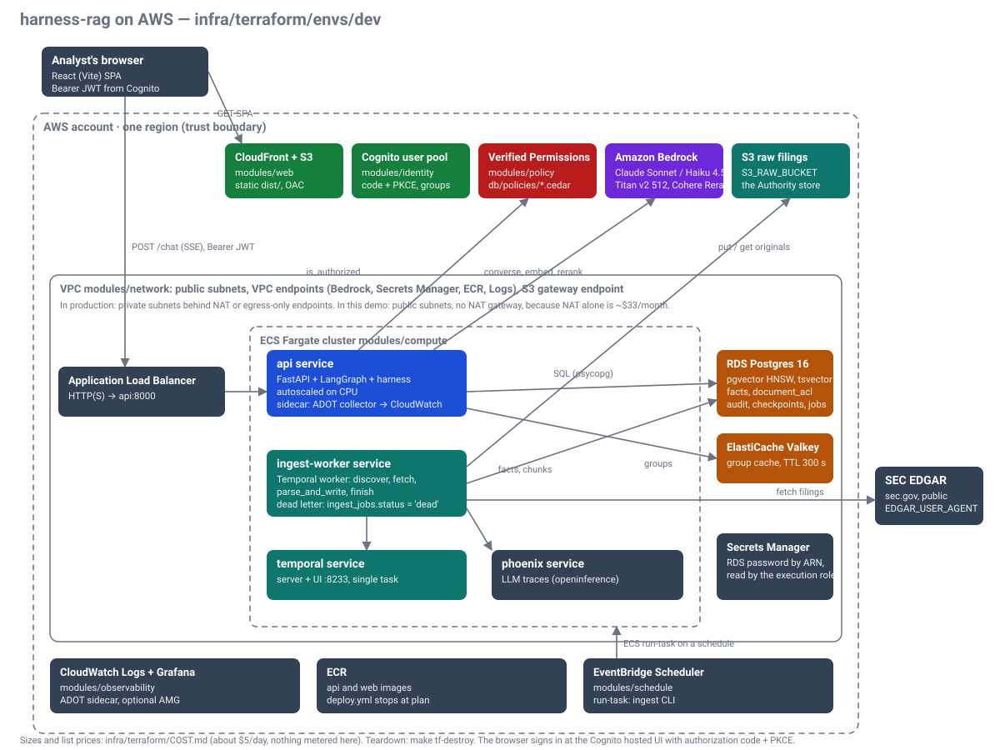

# multi-agent-finance-example

An artificial intelligence (AI) assistant over real company filings that only answers from what you are allowed to see, cites every answer, and asks a human before it acts.

[](https://github.com/stevenmcconnon/multi-agent-finance-example/actions/workflows/ci.yml)
[](LICENSE)
[](pyproject.toml)
[](infra/terraform)

## Contents

This page zooms in three times: first what the thing is, then one screen that names every building block,
then one section per block, then pointers into the code and the longer documents.

- [What this is](#what-this-is) · [What is an SEC filing?](#what-is-an-sec-filing)
- [What you will see](#what-you-will-see) · [Run it yourself](#run-it-yourself)
- [How it works, in one screen](#how-it-works-in-one-screen), then one section per block:
  [Sign-in and permissions](#sign-in-and-permissions) · [Ingestion](#ingestion) ·
  [Embeddings and the vector database](#embeddings-and-the-vector-database) · [Retrieval](#retrieval) ·
  [The agent team](#the-agent-team) · [Human approval and replay](#human-approval-and-replay) ·
  [Models used](#models-used) · [Observability and audit](#observability-and-audit) ·
  [Infrastructure (local vs cloud)](#infrastructure-local-vs-cloud) · [Tests and evals](#tests-and-evals) ·
  [Production vs this demo](#production-vs-this-demo)
- [Repository layout](#repository-layout) · [Decisions](#decisions) · [Built with](#built-with) ·
  [Further reading](#further-reading) · [Glossary](#glossary) · [License](#license)

## What this is

multi-agent-finance-example is a working demo of an AI assistant for a company's document library. The documents here
are real: the annual and quarterly reports that every public company in the United States must file with
the Securities and Exchange Commission (SEC), for Apple and Microsoft. You sign in as one of three example
employees, ask questions in plain English, and get answers with links to the exact pages they came from.

Three things make it different from a chatbot pointed at a folder. First, each person only ever gets
answers from the documents they are allowed to read; the assistant will say it cannot answer rather than
peek at a report you have no access to. Second, numbers such as revenue come from the structured data
tables inside the filings, never from the model's memory. Third, when the assistant wants to do something
rather than say something, such as opening a ticket, a person has to approve it first, and every step is
recorded so you can replay exactly what happened.

Under the hood this is a reference implementation of the plumbing a business needs before it can let an AI
agent loose on private data: identity, permissions, approvals, audit and replay, built on Amazon Web
Services (AWS) and the same open-source tools a production team would use. The author built it as a worked
example of the seven-layer architecture he uses for such systems (cloud, data, models, retrieval, harness,
orchestration, experience), with every layer in one repository and a local mode that runs for $0.

Why the problem exists: enterprise document stores (SharePoint, Confluence, shared drives) carry
permissions per item. A retrieval-augmented generation (RAG) system that ignores them leaks a paragraph
from a file the reader could never open, and an agent that can act needs a gate a human controls. SEC
filings stand in for the SharePoint library because they are public, free, versioned and carry numeric
tables; the access control lists (ACLs) are simulated (`ingest/acl.py`, by form type), and nothing in the
retrieval or policy path knows the difference. It is for engineers evaluating how to run agents in
production. Where the demo takes a cheaper path than production, the code and the docs say so in the same
two-line form ([Production vs this demo](#production-vs-this-demo)).

### What is an SEC filing?

> A document a public company is required to file with the U.S. Securities and Exchange Commission. The
> three used here are the Form 10-K (annual report), the 10-Q (quarterly report) and the 8-K (current
> report, filed when something material happens between the others). They are free to download from
> sec.gov, and each one carries machine-readable financial numbers tagged in eXtensible Business Reporting
> Language (XBRL) plus a permanent accession number, which is why they suit a demo about citing and
> re-checking sources. In this project they stand in for a company's private documents, whose per-document
> permissions are simulated.

## What you will see

Three seeded identities make the behaviour visible: **alice** (analyst; groups finance, analysts) reads
10-K, 10-Q and 8-K filings; **bob** (viewer; engineering) reads 8-Ks only; **carol** (admin) may call
write tools but belongs to no reader group.
The chat page offers these prompts ([screenshot](docs/screenshots/11-examples.png)).

1. **Sign in as alice, ask about Apple's supply chain.** The answer cites the 10-K, and the timeline shows
   each step: the policy decision, the plan, the tool call, the chunks retrieved, the verifier's verdict
   ([screenshot](docs/screenshots/02-alice-chat.png)). Proves: a grounded, cited answer with the whole turn visible.
2. **Re-ask as bob.** Same question, second column: bob abstains, because his permissions reach only the
   8-Ks and the 8-Ks do not answer it ([screenshot](docs/screenshots/10-persona-compare.png),
   [bob alone](docs/screenshots/05-bob-chat.png)). Proves: the 10-K never entered the prompt, the reranker
   or the audit row for bob.
3. **Ask a revenue question.** The number comes from the XBRL facts table, cited to its source row, never
   from prose. Proves: a figure is read, not generated.
4. **As carol, create a ticket.** The run pauses at an approval card; Deny changes nothing, Approve runs the
   tool exactly once ([card](docs/screenshots/07-carol-hitl.png), [after approval](docs/screenshots/08-carol-approved.png)).
   Proves: a write needs a human, and the same approval cannot run it twice.
5. **Open Replay and Documents.** Replay lists the checkpoint each node wrote
   ([screenshot](docs/screenshots/04-replay.png)); Documents lists what the signed-in user may read, from the
   same Structured Query Language (SQL) predicate retrieval uses
   ([alice](docs/screenshots/03-alice-documents.png), [bob](docs/screenshots/06-bob-documents.png)).
   Proves: every step is recorded and the permissions are server-side.

The scripted version with what to say at each step: [docs/DEMO.md](docs/DEMO.md).

## Run it yourself

About 10 minutes, $0. Nothing calls AWS; the model gateway is a deterministic fake and the embedding and
reranking models run locally.

**Prerequisites:** Docker (with Compose), and a contact e-mail: SEC's Electronic Data Gathering, Analysis,
and Retrieval system (EDGAR) answers 403 to a request without an app name and e-mail in its `User-Agent`.

```sh
cp .env.example .env
# edit this line in .env:  EDGAR_USER_AGENT=multi-agent-finance-example you@example.com
make up        # builds and starts everything (first run downloads images and models)
make ingest    # AAPL and MSFT, 10-K and 8-K, newest 2 each, run inline inside the api container
```

`make up` starts: Postgres with pgvector (`:5432`), Valkey (`:6379`), the Temporal dev server (`:7233`,
UI `:8233`), Phoenix traces (`:6006`), the OpenTelemetry collector (`:4318`), the API (`:8000`) and the web
app (`:3000`). The API container applies `db/migrations` (0002 seeds the org `acme` and alice, bob, carol)
before it serves. If port 3000 is taken: `WEB_PORT=3100 make up`.

Open http://localhost:3000 and walk the five steps. Sign-in is a persona picker (local mode only); once in,
the header has a persona switcher.

- [ ] Pick **alice**; ask `What risks does Apple describe about its supply chain?`
- [ ] Under the answer click **Re-ask as bob**; read the abstention in the second column
- [ ] Ask `What was AAPL revenue for the fiscal year ending September 2026?`; the citation is a facts row
- [ ] Switch to **carol**; ask `Create a ticket to review Apple's 10-K risk section`; click Deny, ask again, Approve
- [ ] Click **Replay this turn**; open **Documents** as alice, then as bob

Same tools over the Model Context Protocol (MCP), same door (needs `uv`):
`HR_TOKEN=$(uv run python -m finance_agents.harness.devtoken alice) uv run python -m finance_agents.mcp_server.server`.
Write tools are listed for an admin but answer `approval_required`: approval happens only in the UI.

## How it works, in one screen

One bullet per building block, in the order a question travels. Each links to its own section below.

- **[Sign-in and permissions](#sign-in-and-permissions).** A signed token names the user; the database, never
  the token or the prompt, says which groups they hold, and one SQL predicate turns that into "which documents may this person read".
- **[Ingestion](#ingestion).** A Temporal workflow fetches each filing from EDGAR, splits it into sections and
  chunks, pulls the XBRL numbers into a facts table and writes it all in one transaction.
- **[Embeddings and the vector database](#embeddings-and-the-vector-database).** Yes, it creates embeddings: every
  chunk becomes a 512-number vector in Postgres with the pgvector extension, next to a keyword index; one store, one permission filter.
- **[Retrieval](#retrieval).** A question is searched two ways (meaning and keywords), both permission-filtered in
  SQL; the lists are fused, a reranker orders them and drops the irrelevant ones.
- **[The agent team](#the-agent-team).** A fixed LangGraph graph runs seven named steps; four are model calls,
  each boxed in by a deterministic check before and after it.
- **[Human approval and replay](#human-approval-and-replay).** A write tool pauses the graph until a person
  clicks Approve; every step is checkpointed, so a turn can be replayed later.
- **[Models used](#models-used).** Which model does what, locally (free, deterministic) and in cloud mode (Amazon Bedrock).
- **[Observability and audit](#observability-and-audit).** Every decision, retrieval and tool call writes an audit
  row; every span goes to OpenTelemetry and Phoenix.
- **[Infrastructure (local vs cloud)](#infrastructure-local-vs-cloud).** The seven layers and their folders, the
  AWS deployment in Terraform, and what a real sizing would start from.
- **[Tests and evals](#tests-and-evals).** Unit tests per layer, architecture rules as tests, and two adversarial
  suites that hunt for a leaked document id.
- **[Production vs this demo](#production-vs-this-demo).** Every place the demo takes a cheaper path, in one table.

## Sign-in and permissions

**An unauthorized chunk never enters a prompt, a reranker, a log, a cache or an eval dataset.** Each place
that could break it has one owner and one test.

| Where it could leak | What enforces it | What proves it |
|---|---|---|
| Candidate retrieval (dense, sparse) | `retrieval/sql.py` `ACL_PREDICATE`, spliced into `DENSE_SQL` and `SPARSE_SQL` in the `WHERE`, before `ORDER BY`/`LIMIT` | `tests/test_retrieval.py::test_acl_predicate_in_dense_and_sparse_and_facts`; `tests/test_architecture.py::test_every_chunk_or_fact_query_carries_the_acl_predicate`; database-backed `test_db_acl_filters_rows_end_to_end` |
| Fusion and rerank | `retrieval/hybrid.py` `PgHybridRetriever.retrieve`: `rrf_fuse` and `Reranker.rerank` only ever see rows those two queries returned | `tests/test_retrieval.py::test_retriever_fuses_and_audits` (the injected fetch asserts the predicate and the principal's groups on every call) |
| Numeric facts | `retrieval/sql.py` `FACTS_SQL` carries the same predicate; `tools.cedar` also denies `facts_sql` to viewers | `tests/test_authz.py::test_facts_sql_tool_requires_analyst_or_admin`; `evals/suites/test_permission_leak.py::test_viewer_tool_denied_by_cedar_not_by_registry` |
| The prompt | `agent/graph.py` `_evidence` builds the model's evidence only from `state["chunks"]`/`state["facts"]`, which only `harness.runner.run_tool` fills; `harness/tools/search_documents.py` refuses a result whose `acl_filtered` is not `True`; with no evidence the model is not called | `tests/test_agent.py::test_zero_authorized_chunks_abstains_without_calling_the_model`; `evals/suites/test_permission_leak.py` |
| Identity | `harness/identity.py` `verify_token`: signature and `exp` (required) checked; Cognito mode takes the user from `cognito:username` and the org from the one `org:<slug>` group; groups and roles come from the database through `authz/group_cache.py`, never from the token's hint or the prompt; `authz/entities.py` drops unknown roles; `check_config()` refuses to boot `HR_MODE=aws` on local JSON Web Token (JWT) settings | `tests/test_identity.py` (`test_cognito_token_groups_are_only_a_hint`, `test_local_missing_exp_rejected`, `test_cognito_missing_exp_rejected`, `test_check_config_refuses_aws_with_local_jwt`); `tests/test_authz.py::test_prompt_cannot_grant_roles`; `evals/datasets/permission_leak.jsonl` `bob-prompt-injection` |
| Caches | `authz/group_cache.py` caches principal resolution (a denial too), never documents; `harness/runner.py` checks Cedar and the risk gate before it reserves an idempotency key (`org:tool:<call key>`) and stores only authorized results | `tests/test_authz.py::test_group_cache_caches_denial_and_survives_redis_failure`; `tests/test_harness.py::test_idempotent_second_call_is_cached`, `::test_idempotency_key_distinguishes_arguments`, `::test_concurrent_same_key_runs_the_tool_once` |
| Writes | `harness/runner.py` `run_tool`: a `write` or `money` tool returns `approval_required` unless the caller passes `approved=True`, which only the graph's human-in-the-loop (HITL) path does after a human approves; MCP and the application programming interface (API) never pass it | `tests/test_harness.py::test_write_tool_needs_explicit_approval`; `tests/test_mcp.py::test_carol_write_tool_over_mcp_needs_approval`; `tests/test_agent.py::test_create_ticket_declined_changes_nothing` |
| Irrelevant but readable evidence | `retrieval/hybrid.py` drops reranked chunks scoring below the reranker's own floor (`Reranker.min_score`; `HR_RERANK_MIN_SCORE` overrides), so a reader whose permitted documents do not answer the question gets an abstention | `tests/test_retrieval.py::test_rerank_floor_drops_irrelevant_authorized_chunks` |
| Logs and audit | `authz/audit.py` `record`: the `retrieval` row (`hybrid.py`) lists the document ids of the chunks returned after the predicate, nothing earlier | `evals/suites/test_permission_leak.py` walks every audit row and stream event for a forbidden id |
| Eval datasets | `evals/ragas_eval.py` `cited_contexts` reads back only chunk ids the turn cited for that principal | `evals/suites/test_citation_quality.py` (every citation readable by the asking user) |
| The documents page | `api/app.py` `DOCUMENTS_SQL` reuses the same predicate | `tests/test_architecture.py::test_documents_route_reuses_the_predicate` |
| Threads | `agent/graph.py` `_assert_owner`: replay, resume and continuation belong to the principal who started the thread | `tests/test_agent.py::test_thread_belongs_to_its_owner`; `evals/suites/test_permission_leak.py::test_thread_cannot_be_replayed_by_another_user` |
| Policy outage | `authz/cedar_local.py` and `authz/verified_permissions.py` return `allow=False, fail_closed=True` on any error | `tests/test_authz.py::test_authorizer_exception_fails_closed`, `::test_avp_errors_fail_closed` |

Policy decisions ("may this principal answer, may they call this tool") are Cedar policies in `db/policies`,
evaluated in process locally and by Amazon Verified Permissions in cloud mode
([ADR 0002](docs/adr/0002-cedar-for-authorization.md)). Threat model: [docs/SECURITY.md](docs/SECURITY.md).

**Where in the code:** `services/finance_agents/harness/identity.py` (token → Principal),
`services/finance_agents/authz/` (Cedar, group cache, audit), `services/finance_agents/retrieval/sql.py`
(`ACL_PREDICATE`), `db/policies/*.cedar`, `db/migrations/0001_schema.sql` (`principals`, `group_members`,
`document_acl`).

## Ingestion



Retries, backoff and the dead letter are Temporal's and the `ingest_jobs` table's; there is no queue
service in the path ([ADR 0003](docs/adr/0003-temporal-owns-ingestion-durability.md) says when one would be
the better answer). The same activities run inline without Temporal (`cli run --inline`), which is how
`make ingest` works. JSON is JavaScript Object Notation. Each filing's ACL rows are assigned by form type
in `ingest/acl.py`; why EDGAR is the corpus at all is [ADR 0004](docs/adr/0004-edgar-as-the-corpus.md).

**Where in the code:** `services/finance_agents/ingest/` (`edgar.py` fetch, `parse.py` sections and chunks,
`facts.py` XBRL, `acl.py`, `writer.py` one transaction per filing, `workflow.py` and `worker.py` Temporal,
`cli.py`).

## Embeddings and the vector database

Yes: this project creates embeddings and keeps them in a vector database, and the database is Postgres.

- **What gets embedded.** `parse.py` splits each filing into sections and then into chunks of about 700
  words with an 80-word overlap. Each chunk is turned into a vector of 512 numbers.
- **Which model.** Locally, `jinaai/jina-embeddings-v2-small-en` through fastembed: it runs on the
  processor, needs no graphics card and costs $0. In cloud mode, Amazon Titan Text Embeddings v2
  (`amazon.titan-embed-text-v2:0`) asked for 512 dimensions natively, so the same column fits both
  ([ADR 0005](docs/adr/0005-512-dim-embeddings.md)). `HR_EMBED_BACKEND` picks one; `embed.py` raises if a
  model returns any other length.
- **Where they live.** The `chunks` table has an `embedding vector(512)` column from the pgvector
  extension, under a Hierarchical Navigable Small World (HNSW) index for cosine distance
  (`chunks_embedding_idx`). Beside it, `content_tsv` is a generated full-text column under a Generalized
  Inverted Index (GIN), so keyword search uses the same table and the same permission predicate.
- **Why Postgres and not a dedicated vector store.** The jobs, audit, checkpoints, idempotency keys and
  identity mirror already need a relational database; putting the index next to `document_acl` means the
  permission filter is one SQL predicate that can be proven with a string test, instead of a second store
  whose metadata filters have to be kept in sync ([ADR 0001](docs/adr/0001-pgvector-over-opensearch.md)).
- **The query path, in one sentence.** The question is embedded with the same model, `DENSE_SQL` finds the
  nearest authorized chunks by cosine distance, and the result is fused with the keyword list described
  under [Retrieval](#retrieval).

**Where in the code:** `services/finance_agents/retrieval/embed.py` (both embedders, `EMBED_DIM = 512`),
`services/finance_agents/ingest/parse.py` (`chunk(size=700, overlap=80)`), `db/migrations/0001_schema.sql`
(`chunks`, `chunks_embedding_idx`, `chunks_tsv_idx`), `services/finance_agents/retrieval/sql.py` (`DENSE_SQL`,
`SPARSE_SQL`).

## Retrieval

One question becomes two SQL queries, each carrying the ACL predicate in its `WHERE`: `DENSE_SQL` (pgvector
cosine, top 24) and `SPARSE_SQL` (Postgres full-text with `websearch_to_tsquery` and `ts_rank_cd`, top 24).
`rrf_fuse` merges the two lists with reciprocal rank fusion (RRF, k = 60), a cross-encoder reranker orders
the merged candidates and keeps 8, and anything under the reranker's relevance floor is dropped
([ADR 0009](docs/adr/0009-rerank-relevance-floor.md)), so a reader whose permitted documents do not answer
the question gets an abstention rather than a stretch. Numeric questions go to `FACTS_SQL` over the XBRL
`facts` table instead of prose. No LangChain retriever classes sit in this path
([ADR 0006](docs/adr/0006-no-langchain-retrieval-abstractions.md)).

### A request, end to end



The human-in-the-loop `interrupt()` sits inside `act`, before a write or money call runs, and `approve()`
resumes it. With `HR_MODEL_BACKEND=fake` the plan is a deterministic heuristic. SPA is single-page
application; SSE is server-sent events.

**Where in the code:** `services/finance_agents/retrieval/` (`sql.py`, `hybrid.py`, `rerank.py`, `facts.py`),
`services/finance_agents/harness/tools/search_documents.py`, `services/finance_agents/harness/runner.py`.

## The agent team

One LangGraph graph is the **Supervisor**: deterministic routing between specialized agents, checkpointed
and replayable. The node names are unchanged from the single-graph design (`understand`, `policy`, `plan`,
`act`, `generate`, `verify`, `answer`); each node is one team member acting, and the `status` event names
it (`{node, agent, kind}`). Pinned in [docs/CONTRACTS.md](docs/CONTRACTS.md) "The agent team".



| Agent | Kind | Owns | Model role |
|---|---|---|---|
| Supervisor | deterministic | the graph: fixed edges, routing on state, one checkpoint per node, `answer` / `abstain` | none |
| Guard | deterministic | identity → Principal, Cedar `answer` decision, fail closed | none |
| Planner | model (non-deterministic) | understands the question, chooses tools from `registry.specs_for(principal)` via Bedrock Converse tool use | `understand`, `plan` |
| Researcher | deterministic | runs the planned calls through `harness.runner.run_tool`, assembles evidence (facts first, then chunks), relevance floor | none |
| Approver | human | approves or denies write/money tools through the interrupt | none |
| Writer | model (non-deterministic) | grounded draft from the evidence only, cites by index | `generate` |
| Judge | model (non-deterministic, second cheaper model) | verifies every claim against the evidence; one retry, then abstain | `verify` |

In production: a model-driven supervisor with handoffs and a re-plan loop once evidence arrives (`plan()`
already takes an `evidence_summary`; the graph passes `None` today). In this demo: fixed edges, because the
task is one question and fixed edges are provable and replayable.



Blue nodes are deterministic, red nodes are model calls, the orange one is a person. The deterministic
parts are everything that must be provable: identity resolution, the Cedar decision, the SQL ACL filter,
reciprocal rank fusion, the facts table and the calculator, turn budgets, circuit breakers and idempotency.
The non-deterministic parts are the four model calls (understand, plan, generate, verify), and each sits
between a deterministic gate before it (policy, `specs_for`, the ACL-filtered evidence) and after it (the
Cedar check in `run_tool`, the verifier's JSON parsed into `Verification`, the citation map). A model call
can therefore change *which authorized evidence* ranks first and *how the answer reads*, never *who sees
what* or *what runs*. Two orchestrators at two grains: LangGraph runs the turn (seconds, checkpointed,
resumable after a human), Temporal runs ingestion (minutes to hours, retried with backoff, dead-lettered);
neither is used for the other's job. Architecture decision record (ADR)
[0008](docs/adr/0008-model-driven-tool-selection.md) covers the model-driven plan.

**Where in the code:** `services/finance_agents/agent/graph.py` (the graph), `services/finance_agents/agent/team.py`
(agent names and kinds), `services/finance_agents/harness/` (`registry.py`, `runner.py`, `budget.py`, `tools/`),
`services/finance_agents/gateway/` (the four model calls).

## Human approval and replay

A `write` or `money` tool (today: `create_ticket`) never runs on the model's say-so. Inside the `act` node
the graph calls LangGraph's `interrupt()` before the call, the web app shows an approval card, and the turn
waits. Deny ends the turn with nothing changed; Approve resumes the graph, which calls `run_tool` with
`approved=True` once. The idempotency key (`org:tool:<call key>`) means the same approval cannot run the
tool twice, and the MCP server and the HTTP API never pass `approved=True` at all. Every node writes one
checkpoint to Postgres (`AsyncPostgresSaver`; `MemorySaver` in tests), which is what the Replay page lists,
and `_assert_owner` keeps replay, resume and continuation to the principal who started the thread.

**Where in the code:** `services/finance_agents/agent/graph.py` (`interrupt`, `approve`, `_assert_owner`),
`services/finance_agents/harness/runner.py` (`approved`, idempotency, `IN_PROGRESS_WAIT_S`), `apps/web/src`
(approval card, Replay page), `db/migrations/0001_schema.sql` (`idempotency_keys`).

## Models used

Two switches pick the backends: `HR_MODEL_BACKEND` (`fake` | `bedrock`) for the language models, and
`HR_EMBED_BACKEND` / `HR_RERANK_BACKEND` (`fastembed` | `bedrock`; rerank also `none`) for the small models.
The ids below are the defaults in `config.py`; none of them is downloaded or called until first use.

| Purpose | Local demo ($0, offline) | Cloud mode (Amazon Bedrock) |
|---|---|---|
| Understand the question, plan tool calls, write the answer (`understand`, `plan`, `generate`) | `gateway/fake.py`: deterministic heuristics over the evidence lines | Claude Sonnet 4.5, `anthropic.claude-sonnet-4-5-20250929-v1:0`, via Bedrock Converse with tool use |
| Judge: verify every claim against the evidence (`verify`) | `gateway/fake.py` | Claude Haiku 4.5, `anthropic.claude-haiku-4-5-20251001-v1:0` (the second, cheaper model) |
| Embeddings (512 numbers per chunk and per question) | `jinaai/jina-embeddings-v2-small-en` via fastembed, on the processor | Amazon Titan Text Embeddings v2, `amazon.titan-embed-text-v2:0`, `dimensions=512` |
| Reranker (orders candidates, sets the relevance floor) | `BAAI/bge-reranker-base` via fastembed, floor 0.0 (a logit) | Cohere Rerank 3.5, `cohere.rerank-v3-5:0`, floor 0.15 (a 0 to 1 relevance) |

The gateway modules and `embed.py` / `rerank.py` are the only code that speaks to a model vendor
(`tests/test_architecture.py` keeps `boto3` behind them). If the Bedrock planner call fails, the plan falls
back to the fake heuristic.

**Where in the code:** `services/finance_agents/config.py` (model ids), `services/finance_agents/gateway/`
(`bedrock.py`, `fake.py`), `services/finance_agents/retrieval/embed.py`, `services/finance_agents/retrieval/rerank.py`.

## Observability and audit

Two records are kept of every turn. The **audit** is a table: `authz/audit.py` `record` writes one
`audit_events` row for each policy decision, retrieval, tool call, approval and answer, with the thread id
and the document ids involved after the permission filter; a failed audit write is logged, never raised,
because the decision it records was already taken fail-closed. The **traces** are spans: `observability/otel.py`
sets up one OpenTelemetry tracer that exports to the local collector (`:4318`) and to Arize Phoenix
(`:6006`, where the LangGraph spans appear), instruments FastAPI and psycopg, and serves Prometheus
metrics at `/metrics`. A collector that is down costs dropped spans, not a failed start. In production the
collector sidecar fans out to X-Ray or Tempo with sampling; in this demo every span is exported, because the
traffic is one developer.

**Where in the code:** `services/finance_agents/authz/audit.py`, `services/finance_agents/observability/otel.py`,
`infra/otel/` (collector config), `infra/grafana/`, `db/migrations/0001_schema.sql` (`audit_events`).

## Infrastructure (local vs cloud)

### The stack



| Layer | Folder | Role |
|---|---|---|
| L7 Experience | `apps/web`, `services/finance_agents/api`, `services/finance_agents/mcp_server` | React (Vite) SPA; FastAPI streaming SSE; MCP server over the same tools |
| L6 Orchestration | `services/finance_agents/agent`, `ingest/workflow.py` | `graph.py` (the Supervisor graph, LangGraph); the Temporal ingestion workflow |
| L5 AI Harness | `services/finance_agents/harness` | `identity.py`, `registry.py`, `runner.py` (the one tool door), `budget.py`, `tools/` |
| L4 Knowledge / Retrieval | `services/finance_agents/retrieval`, `services/finance_agents/authz` | `sql.py` (the predicate), `hybrid.py`, `facts.py`; `cedar_local.py`, `group_cache.py`, `audit.py` |
| L3 Models | `services/finance_agents/gateway`, `retrieval/embed.py`, `retrieval/rerank.py` | `bedrock.py`, `fake.py`; the only modules that speak to a model vendor |
| L2 Data / Pipelines | `services/finance_agents/ingest` | `edgar.py`, `parse.py`, `facts.py`, `writer.py` (one transaction per filing) |
| L1 Cloud / Platform | `infra/terraform`, `infra/otel`, `infra/grafana`, `services/finance_agents/observability` | `envs/dev/main.tf`; collector config; `otel.py` |

Locally, `docker-compose.yml` runs the whole stack on one laptop ([Run it yourself](#run-it-yourself)).

### AWS deployment



Terraform lives in `infra/terraform` (modules `network`, `database`, `cache`, `web`, `identity`, `policy`,
`observability`, `compute`, `schedule`; environment `envs/dev`). The Cedar policies in `db/policies` are the
same files `modules/policy` uploads to the Verified Permissions store, so switching `HR_AUTHZ_BACKEND`
changes where Cedar runs, not what it decides. Sign-in in cloud mode is Cognito with the authorization code
flow and Proof Key for Code Exchange (PKCE) ([ADR 0007](docs/adr/0007-pkce-not-implicit.md)).

### Deploy to AWS

```sh
cd infra/terraform/envs/dev
terraform init && terraform apply          # VPC, RDS, Valkey, Cognito, Verified Permissions, ECS, ALB, CloudFront, scheduler
cd ../../../../apps/web && pnpm build && aws s3 sync dist s3://<web_bucket from the outputs>
make tf-destroy                             # scripts/teardown.sh: empties ECR, then terraform destroy; nothing keeps billing
```

The dev environment is sized to list prices of about **$5/day** (`infra/terraform/COST.md` itemizes it;
nothing there was metered from a live run). `.github/workflows/deploy.yml` builds images and stops at
`terraform plan`; `apply` stays a human command.

### Sizing, honestly

No load, latency or scale figure in this repository was measured, so none is claimed. What a production
sizing starts from:

- **Peak queries per second (QPS) versus concurrent users.** A turn is up to four model calls plus two SQL
  queries and a rerank; the model calls dominate wall time and Bedrock quotas. Size Fargate on concurrent
  streams, not requests per second.
- **95th-percentile latency (p95) target.** The rerank and the verifier are the two optional stages: the
  verifier can be sampled, the reranker dropped to `HR_RERANK_BACKEND=none`, each with a measured quality cost first.
- **Churn and freshness.** Each filing version is one idempotent job; `writer.py` skips an unchanged
  content hash. A permission change is an ACL row update plus a `GroupCache.invalidate`; the 300-second
  time to live (TTL) bounds how stale a membership can be.
- **At 5 to 20 million chunks.** The pgvector HNSW index build time and memory become the constraint before
  query latency; partition by org, tune `ef_search`, and expect the ACL `EXISTS` to be the planner's hardest
  decision.
- **When OpenSearch wins.** When sparse retrieval needs Best Match 25 (BM25) ranking with field boosts
  Postgres full-text does not offer, or the index must scale independently of the transactional database.
  Until then one store with one predicate is simpler to prove correct ([ADR 0001](docs/adr/0001-pgvector-over-opensearch.md)).

**Where in the code:** `docker-compose.yml`, `Makefile`, `infra/terraform/` (modules, `envs/dev`, `COST.md`),
`infra/otel/`, `infra/grafana/`, `scripts/teardown.sh`, `.github/workflows/`.

## Tests and evals

```sh
uv run pytest tests evals/suites -q   # 140 passed on 2026-11-10; DB-backed cases skip unless DATABASE_URL answers
uv run pytest evals/suites -q         # the permission-leak and citation suites alone
```

- `tests/test_authz.py`, `test_retrieval.py`, `test_ingest.py`, `test_harness.py`, `test_agent.py`,
  `test_gateway.py`: unit tests per layer, offline, with injected fetches, fake Redis and `MemorySaver`
  (`test_gateway.py` covers the fake planner and Bedrock tool-use parsing with a stubbed client).
- `tests/test_identity.py`: local and Cognito claim mapping, missing and expired `exp`, wrong key,
  `check_config`. `tests/test_api.py`: dev token, chat stream, foreign-thread 403, input limits, `/healthz`
  503, aws boot refusal. `tests/test_mcp.py`: the MCP server per principal (database-backed).
- `tests/test_architecture.py`: the rules as tests: `boto3` only behind its doors, the agent never imports
  psycopg, every chunk or fact query carries the predicate before `LIMIT`, the documents route reuses it.
- `evals/suites/test_permission_leak.py`: eight adversarial cases (`evals/datasets/permission_leak.jsonl`)
  through the real graph; asserts abstention or a readable-only answer, and no forbidden document id in any
  event, citation or audit row.
- `evals/suites/test_citation_quality.py`: twelve cases (`evals/datasets/qa.jsonl`); every non-abstained
  answer is verifier-grounded and cites a readable document of the required form. No gold answers.
- `evals/ragas_eval.py`, `evals/deepeval_eval.py`: optional graded evals (faithfulness, answer relevancy,
  context precision / relevancy) against the live stack with `uv run --extra evals`; they skip without a
  Bedrock backend and write to `eval_records`. Details in [evals/README.md](evals/README.md).
- Records of the review passes: [docs/AUDIT_2026-11-10.md](docs/AUDIT_2026-11-10.md) (code audit),
  [docs/QA_2026-11-10.md](docs/QA_2026-11-10.md) (exploratory quality assurance, QA).

**Where in the code:** `tests/`, `evals/suites/`, `evals/datasets/`, `evals/ragas_eval.py`, `evals/deepeval_eval.py`.

## Production vs this demo

| Concern | In production | In this demo, because |
|---|---|---|
| Supervisor routing | A model-driven supervisor with handoffs and a re-plan loop after evidence arrives (`plan()` takes `evidence_summary` for it) | Fixed graph edges, routing on state; the graph passes `evidence_summary=None`; one question per turn, provable and replayable |
| Researcher | A research sub-loop (query rewriting, multi-hop) under the same `run_tool` door | One pass over the planned calls, deterministic; the demo corpus is two companies |
| Judge | The verifier tuned on labelled data, with offline evals in the release gate | A second cheaper model with one retry; Ragas and DeepEval scripts exist in `evals/` and have never been run against Bedrock here |
| Approver | Approvals routed to Slack or Teams behind single sign-on (SSO), with an audit of who approved | A card in the web UI; the audit row records the thread, not a named approver |
| Human waits | Multi-day waits as a Temporal workflow | A LangGraph checkpoint parked at `interrupt()`; fine for minutes, never tested for days |
| Model gateway | Bedrock only | `gateway/fake.py` plans and writes deterministically so tests and the $0 quickstart run offline |
| Duplicate writes in flight | Postgres `LISTEN`/`NOTIFY` or a queue to wake the second caller | The loser polls the reserved key for up to 2 seconds (`IN_PROGRESS_WAIT_S` in `harness/runner.py`), else `in_progress` |
| Tracing | Sampled; the collector fans out to X-Ray / Tempo and a managed tracing backend | Every span to the local OpenTelemetry collector and Phoenix (`observability/otel.py`) |
| Policy evaluation | Amazon Verified Permissions (`authz/verified_permissions.py`) | Cedar in process with `cedarpy` (`authz/cedar_local.py`); same policies, same entity mapping; no AWS call per decision at $0 |
| Generation / verification | Claude Sonnet 4.5 generates, Claude Haiku 4.5 verifies and classifies, on Bedrock | `gateway/fake.py`: deterministic answers built only from the evidence lines; offline tests |
| Embeddings | Titan Text Embeddings v2 at 512 dimensions | `jinaai/jina-embeddings-v2-small-en` via fastembed, also 512, so the column never changes |
| Reranker | Cohere Rerank 3.5 on Bedrock | `BAAI/bge-reranker-base` via fastembed |
| Corpus and ACLs | SharePoint with Microsoft Graph permissions | EDGAR public filings with ACLs assigned by form (`ingest/acl.py`); public data, no connector licence |
| Identity | Cognito, authorization code + PKCE, RSA-signed (RS256) JSON Web Key Set (JWKS); one person, one sign-in; user from `cognito:username`, org from the `org:<slug>` group | HMAC-signed (HS256) development tokens from `/auth/dev-token`, local issuer; groups still resolved from the database; `HR_MODE=aws` refuses to boot on these settings |
| Persona switch | None: a user is one Cognito identity | A header persona switcher and "Re-ask as <persona>" chips (local mode only), because the demo's point is the same question under different permissions |
| Relevance floor | `HR_RERANK_MIN_SCORE` tuned against the production reranker's score scale on labelled questions | Each reranker carries a default (Best General Embeddings (BGE) logits 0.0, Cohere relevance 0.15) set from one observed failure (bob on the Apple question), not tuned ([ADR 0009](docs/adr/0009-rerank-relevance-floor.md)) |
| Idempotency rows | A retention job expires old `idempotency_keys` rows | Rows never expire; nothing deletes them |
| Approvals | A human approves in the product UI; other channels cannot | Same: only the UI path passes `approved=True`; MCP is read-only for write tools |
| Durable ingestion | Temporal on Fargate or Temporal Cloud, workers as a service | `temporal server start-dev` in compose; `cli run --inline` runs the same activities without it |
| Raw originals | S3 (`S3_RAW_BUCKET`) | `data/edgar/` when no bucket is set; one laptop |
| Tool selection | Claude picks tools via Bedrock Converse tool use over `specs_for(principal)` | `gateway/fake.py` `plan_heuristic`: facts for numeric questions, a regex for the one write tool, else search; Bedrock falls back to it if the planner call fails |
| Ticketing | Jira / ServiceNow client | `create_ticket` writes an audit row; the approval path is the real one |
| Section detection | Layout-aware splitter (Item N. headings); Portable Document Format (PDF) via PyMuPDF or Textract | `h1`–`h6` only, rest is `preamble`; HyperText Markup Language (HTML) only, because EDGAR primary documents are HTML (`ingest/parse.py`) |
| EDGAR coverage | Paged `filings.files` history | `filings.recent` only (`ingest/edgar.py`) |
| Network | Private subnets, network address translation (NAT) or egress endpoints | Public subnets, no NAT (`modules/network`), saves ~$33/month |
| Terraform state | Remote state with locking | Local state in `envs/dev`, so a clone can `init` with no pre-existing resource |
| Deploy | `apply` from a reviewed plan in a protected environment | `deploy.yml` stops at `plan` |
| Checkpoints in tests | `AsyncPostgresSaver` | `MemorySaver`, injected by `graph.configure` |

## Repository layout

The seven layer folders are in [The stack](#the-stack). Each folder below has its own README with the
file-by-file detail.

| Folder | Role | README |
|---|---|---|
| `services/finance_agents/agent` | the Supervisor graph and the agent team | [README](services/finance_agents/agent/README.md) |
| `services/finance_agents/harness` | identity, tool registry, the one tool door, budgets, tools | [README](services/finance_agents/harness/README.md) |
| `services/finance_agents/retrieval` | the predicate, hybrid search, embedders, rerankers, facts | [README](services/finance_agents/retrieval/README.md) |
| `services/finance_agents/authz` | Cedar (local and Verified Permissions), group cache, audit | [README](services/finance_agents/authz/README.md) |
| `services/finance_agents/gateway` | the model gateway: Bedrock and the deterministic fake | [README](services/finance_agents/gateway/README.md) |
| `services/finance_agents/ingest` | EDGAR fetch, parse, XBRL facts, ACLs, writer, Temporal workflow | [README](services/finance_agents/ingest/README.md) |
| `services/finance_agents/api` | FastAPI: `/chat` SSE stream, documents, replay, dev token | [README](services/finance_agents/api/README.md) |
| `services/finance_agents/mcp_server` | the same tools over MCP | [README](services/finance_agents/mcp_server/README.md) |
| `services/finance_agents/observability` | OpenTelemetry, Phoenix, Prometheus | [README](services/finance_agents/observability/README.md) |
| `services/finance_agents/{contracts,interfaces,config,db}.py` | typed contracts, ports, settings, the Postgres door | |
| `apps/web` | the React SPA | [README](apps/web/README.md) |
| `db/migrations`, `db/policies` | `0001_schema.sql`, `0002_seed_dev.sql`; `documents.cedar`, `tools.cedar` | [README](db/README.md) |
| `infra` | Terraform modules and `envs/dev`, collector config, Grafana | [README](infra/README.md) |
| `evals` | adversarial suites, datasets, Ragas and DeepEval scripts | [README](evals/README.md) |
| `tests` | unit and architecture tests | [README](tests/README.md) |
| `docs` | `ARCHITECTURE.md`, `SECURITY.md`, `TOUR.md`, `DEMO.md`, `CONTRACTS.md`, `adr/` | [README](docs/README.md) |

The UI is a Vite + React + TypeScript SPA (React Router, Tailwind, Zod), built to static `dist/` files behind
nginx locally or S3 + CloudFront on AWS. It is a pure client over the SSE interface with nothing to render
on a server, so there is no Next.js.

## Decisions

- [0001 pgvector over OpenSearch](docs/adr/0001-pgvector-over-opensearch.md)
- [0002 Cedar for authorization](docs/adr/0002-cedar-for-authorization.md)
- [0003 Temporal owns ingestion durability](docs/adr/0003-temporal-owns-ingestion-durability.md)
- [0004 EDGAR as the corpus](docs/adr/0004-edgar-as-the-corpus.md)
- [0005 512-dimension embeddings](docs/adr/0005-512-dim-embeddings.md)
- [0006 No LangChain retrieval abstractions](docs/adr/0006-no-langchain-retrieval-abstractions.md)
- [0007 PKCE, not the implicit flow](docs/adr/0007-pkce-not-implicit.md)
- [0008 Model-driven tool selection](docs/adr/0008-model-driven-tool-selection.md)
- [0009 Rerank relevance floor](docs/adr/0009-rerank-relevance-floor.md)

Cross-layer types, entry points and the agent team are pinned in [docs/CONTRACTS.md](docs/CONTRACTS.md).

## Built with

FastAPI · LangGraph · psycopg 3 · pgvector · cedarpy · Temporal · fastembed · boto3 (Bedrock, Verified
Permissions, S3) · Tenacity · pybreaker · OpenTelemetry · Arize Phoenix · MCP · React (Vite) · Tailwind · Zod ·
Terraform.

## Further reading

- [docs/TOUR.md](docs/TOUR.md): a code walk, file by file, in the order a request travels.
- [docs/ARCHITECTURE.md](docs/ARCHITECTURE.md): the seven layers in depth.
- [docs/SECURITY.md](docs/SECURITY.md): the threat model and what each control answers.
- [docs/DEMO.md](docs/DEMO.md): the scripted demo with what to say at each step.

## Glossary

- **10-K, 10-Q, 8-K:** U.S. SEC annual, quarterly and current-event report forms.
- **ACL:** access control list, who may read a document or item.
- **ADOT:** AWS Distro for OpenTelemetry, the tracing sidecar on Fargate.
- **ADR:** architecture decision record, a short note on one design choice.
- **AI:** artificial intelligence.
- **ALB:** Application Load Balancer, the AWS front door for web traffic.
- **API:** application programming interface.
- **AWS:** Amazon Web Services.
- **BGE:** Best General Embeddings, the family of the local reranking model.
- **BM25:** Best Match 25, a classic keyword-ranking formula.
- **ECR:** Amazon Elastic Container Registry, where container images are stored.
- **ECS:** Amazon Elastic Container Service, which runs the containers.
- **EDGAR:** the SEC's public filing system (Electronic Data Gathering, Analysis, and Retrieval).
- **GIN:** Generalized Inverted Index, the Postgres index type used for full-text search.
- **HITL:** human in the loop, a person approves before an action runs.
- **HNSW:** Hierarchical Navigable Small World, a fast vector-search index.
- **HS256:** a signature scheme using one shared secret (HMAC with SHA-256).
- **HTML:** HyperText Markup Language, web pages.
- **JSON:** JavaScript Object Notation, a text data format.
- **JWKS:** JSON Web Key Set, the public keys used to check token signatures.
- **JWT:** JSON Web Token, the signed sign-in token.
- **MCP:** Model Context Protocol, a standard way for AI tools to call functions.
- **NAT:** network address translation, lets private servers reach the internet.
- **p95:** 95th-percentile latency, the time 95 percent of requests beat.
- **PDF:** Portable Document Format.
- **PKCE:** Proof Key for Code Exchange, a safe browser sign-in flow.
- **QA:** quality assurance, manual testing.
- **QPS:** queries per second.
- **RAG:** retrieval-augmented generation, answering from retrieved documents.
- **RDS:** Amazon Relational Database Service, managed Postgres.
- **RRF:** reciprocal rank fusion, merging two ranked lists.
- **RS256:** a signature scheme using a public/private key pair (RSA with SHA-256).
- **S3:** Amazon Simple Storage Service, file storage.
- **SEC:** the U.S. Securities and Exchange Commission.
- **SPA:** single-page application, a web app that loads once.
- **SQL:** Structured Query Language, how the database is queried.
- **SSE:** server-sent events, a one-way stream from server to browser.
- **SSO:** single sign-on, one corporate login for every tool.
- **TTL:** time to live, how long a cached value stays valid.
- **UI:** user interface.
- **VPC:** Virtual Private Cloud, a private network in AWS.
- **XBRL:** eXtensible Business Reporting Language, tagged financial numbers in filings.

## License

[MIT](LICENSE) © 2026 Steven McConnon
